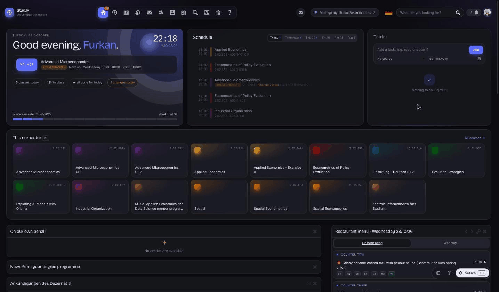
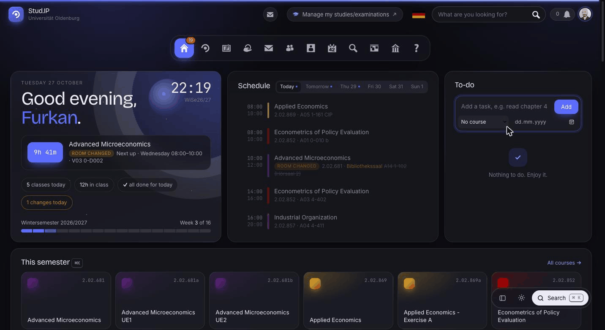
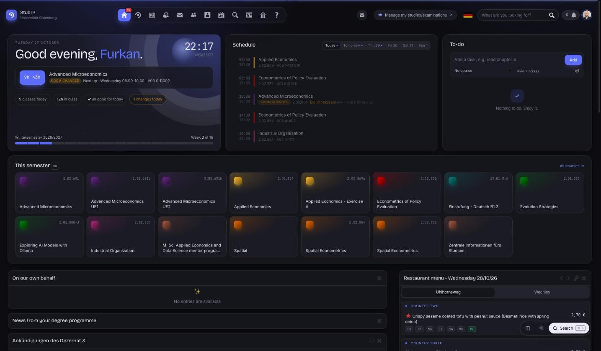
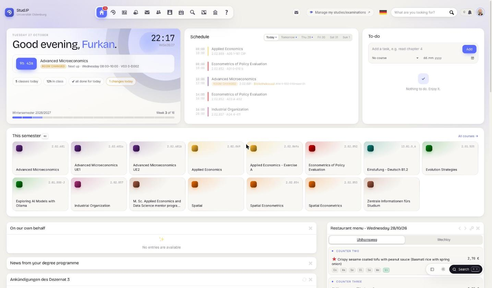
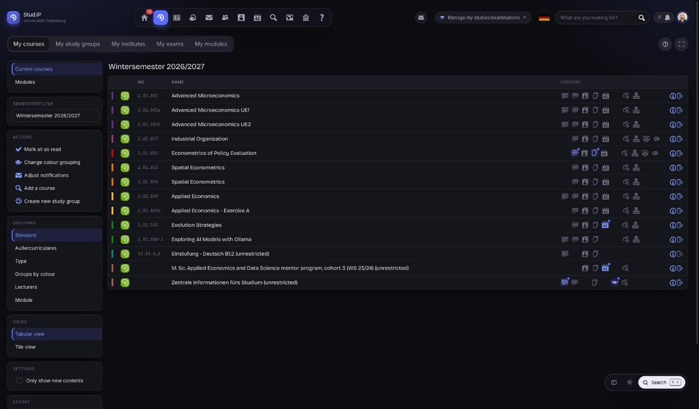

<p align="center">
  
</p>

<h1 align="center">UOL StudIP Theme</h1>

<p align="center">
  A modern redesign of <a href="https://elearning.uni-oldenburg.de">Stud.IP at the University of Oldenburg</a>, delivered as a Chrome extension.<br>
  Dark mode, a daily overview, a command palette and a calmer layout for every page.
</p>

<p align="center">
  
</p>

---

## Features

**A start page that tells you what matters today**
- Greeting with a live clock and a countdown to your next class
- Today's schedule with room changes highlighted, plus a tab for each day of the week
- Semester progress bar and week counter
- A built-in to-do list with course tags and due dates
- Course tiles for the current semester

**Command palette**
- Press <kbd>⌘</kbd> <kbd>K</kbd> (or <kbd>/</kbd>) anywhere to jump to any course, page or action
- Recently used items appear first

<p align="center">
  
</p>

**A consistent look everywhere**
- Light, dark or automatic mode that follows the system
- Eight accent presets or any custom color, or let the accent follow the time of day or the course's color group
- Restyled header, navigation, sidebar, tables, dialogs, forms and editor
- Plugins themed as well: Courseware, Opencast, Forum, Wiki, Blubber, Vips, Evaluation, BigBlueButton, Cliqr, Literature and more
- Blue Stud.IP icons and illustrations are recolored to match your accent
- The university sign-in page gets a matching look

**Class reminders**
- Optional desktop notification 5, 10 or 15 minutes before a class starts

## Screenshots

| Dark | Light |
|---|---|
|  |  |



## Installation

The extension is not in the Chrome Web Store, so it is loaded unpacked:

1. Download this repository (Code → Download ZIP) and unzip it, or clone it.
2. Open `chrome://extensions` in Chrome.
3. Turn on **Developer mode** in the top right corner.
4. Click **Load unpacked** and select the project folder (the one that contains `manifest.json`).
5. Open [elearning.uni-oldenburg.de](https://elearning.uni-oldenburg.de) and sign in.

To update, replace the files and press the reload button (↻) on the extension card.

It also works in other Chromium browsers such as Edge, Brave and Arc.

## Settings

Click the extension icon in the toolbar to open the settings:

| Setting | Options |
|---|---|
| Appearance | Auto, Light, Dark |
| Accent | Fixed color, Time of day, Course color |
| Class reminders | On or off, 5 / 10 / 15 minutes ahead |
| Density | Comfy, Compact |
| Extras | Today panel, background glow, motion, sidebar on the start page |

The switch at the top turns the redesign off completely and brings back the original Stud.IP look.

## Keyboard shortcuts

| Keys | Action |
|---|---|
| <kbd>⌘</kbd> <kbd>K</kbd> or <kbd>/</kbd> | Open the command palette |
| <kbd>⇧</kbd> <kbd>↵</kbd> in the palette | Open the course's files |
| <kbd>[</kbd> | Show or hide the sidebar |
| <kbd>⇧</kbd> <kbd>D</kbd> | Toggle dark mode |

On Windows and Linux use <kbd>Ctrl</kbd> instead of <kbd>⌘</kbd>.

## Privacy

- Everything runs in your browser. No data is sent anywhere except to Stud.IP itself.
- Your courses and schedule are read through Stud.IP's own API while you are signed in, and cached locally.
- Settings and to-dos are stored with Chrome sync storage, so they follow you across devices; the course cache stays in local storage.
- Permissions: `storage` for settings, `alarms` and `notifications` for class reminders, and access to `elearning.uni-oldenburg.de` and `auth.uni-oldenburg.de` only.

## Project structure

```
manifest.json      Extension manifest (Manifest V3)
popup/             Settings window
src/boot.js        Applies settings before the page paints
src/theme.css      Main theme for Stud.IP pages
src/components.css Today panel, to-do list and palette styles
src/motion.*       Animations and the time-of-day sky
src/data.js        Stud.IP API access with a local cache
src/today.js       Start page overview
src/todo.js        To-do list
src/palette.js     Command palette
src/notify.js      Class reminder scheduling
src/background.js  Service worker for notifications
src/auth.css       Sign-in page styles
icons/             Extension icons
```

## Disclaimer

This is an unofficial, personal project. It is not affiliated with or endorsed by the University of Oldenburg or the Stud.IP project. Stud.IP is a trademark of its respective owners.

## Author

<a href="https://github.com/ofurkancoban">
  
</a>

Made by **[Furkan Çoban](https://github.com/ofurkancoban)**

<br clear="left">
